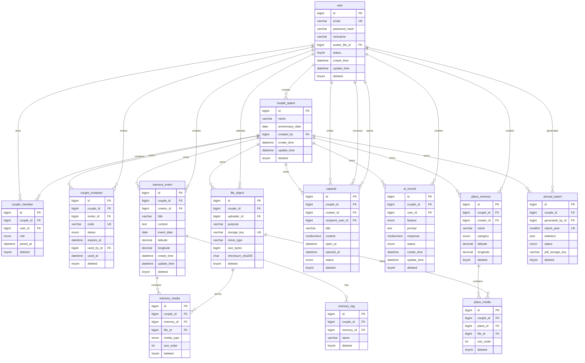

# Our Galaxy 数据库 ER 图

## ER 图

## 关键约束

1. 空间业务表都包含 `couple_id`，详情、修改、删除和回忆文件下载必须同时校验资源 ID 与当前空间 ID；个人头像文件是例外，`file_object.couple_id` 允许为 `NULL`，必须按 `uploader_id` 隔离。
2. `couple_member` 通过 `(couple_id, user_id)` 唯一索引防止重复加入；每个空间最多两名正式成员的限制由 Phase 1 的空间行锁与成员事务共同保证。
3. `memory_media`、`memory_tag`、`place_media` 使用 `(资源 ID, couple_id)` 复合外键，避免把其他空间的资源挂接到当前空间。
4. `file_object.storage_key` 全局唯一；`purpose=MEMORY` 时校验空间成员关系与 `couple_id`，`purpose=AVATAR` 时仅允许 `uploader_id` 本人访问，两类文件不能互换用途。
5. `capsule.content` 在数据库中持久化，但未到 `open_at` 或状态不是 `OPENED` 时，服务端不得返回正文。
6. `annual_report.statistics` 保存真实统计快照；AI 只生成叙事文本，不得生成或修改统计数字。
7. `user.email`、`couple_invitation.code`、`file_object.storage_key` 和 `(couple_id, report_year)` 使用唯一索引。
8. 所有主键为 `BIGINT`，字符集为 `utf8mb4`，业务表支持软删除。

## 时间规范

- `DATETIME(6)` 表示 UTC 时间，数据库连接统一设置 `serverTimezone=UTC`，Java 层使用 `Instant` 或 `OffsetDateTime`。
- `DATE` 只表示纪念日、回忆日期等本地日历日期，不附加时区。
- 创建时间使用数据库当前 UTC 时间，更新时间由 `ON UPDATE CURRENT_TIMESTAMP(6)` 维护。
- Redis Key、对象存储路径和导出文件名都应包含 `coupleId`；个人头像路径包含 `userId`。路径本身不能作为权限依据。
